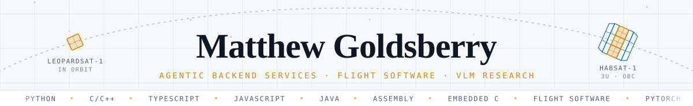
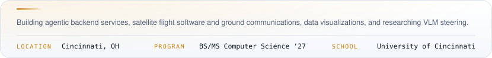
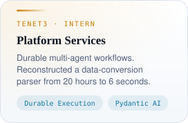
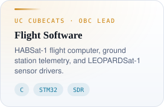
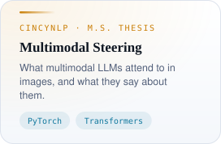
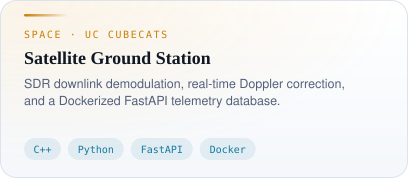
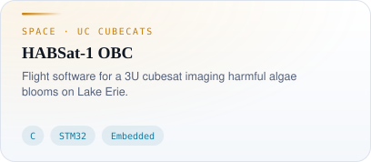
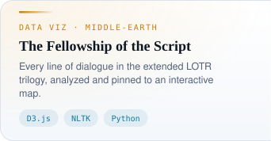
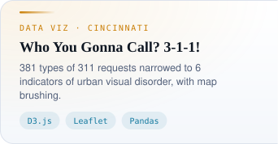

<picture>
<source media="(prefers-color-scheme: dark)" srcset="assets/banner-dark.svg" />

</picture>

<a href="https://matthewgoldsberry.github.io/"><picture><source media="(prefers-color-scheme: dark)" srcset="assets/cards/pill-portfolio-dark.svg" /></picture></a>
<a href="https://matthewgoldsberry.github.io/resume/"><picture><source media="(prefers-color-scheme: dark)" srcset="assets/cards/pill-resume-dark.svg" /></picture></a>
<a href="https://www.linkedin.com/in/matthew-goldsberry/"><picture><source media="(prefers-color-scheme: dark)" srcset="assets/cards/pill-linkedin-dark.svg" /></picture></a>
<a href="mailto:goldsbme@mail.uc.edu"><picture><source media="(prefers-color-scheme: dark)" srcset="assets/cards/pill-email-dark.svg" /></picture></a>

<picture><source media="(prefers-color-scheme: dark)" srcset="assets/cards/about-dark.svg" /></picture>

<a href="https://matthewgoldsberry.github.io/experience/"><picture><source media="(prefers-color-scheme: dark)" srcset="assets/cards/tenet3-dark.svg" /></picture></a>
<a href="https://uccubecats.github.io/"><picture><source media="(prefers-color-scheme: dark)" srcset="assets/cards/cubecats-dark.svg" /></picture></a>
<a href="https://jiangtianyu.com/lab/"><picture><source media="(prefers-color-scheme: dark)" srcset="assets/cards/cincynlp-dark.svg" /></picture></a>

<a href="https://matthewgoldsberry.github.io/projects/ground-station/"><picture><source media="(prefers-color-scheme: dark)" srcset="assets/cards/ground-station-dark.svg" /></picture></a>
<a href="https://matthewgoldsberry.github.io/projects/habsat-1/"><picture><source media="(prefers-color-scheme: dark)" srcset="assets/cards/habsat-1-dark.svg" /></picture></a>

<a href="https://the-fellowship-of-the-script.vercel.app/"><picture><source media="(prefers-color-scheme: dark)" srcset="assets/cards/fellowship-dark.svg" /></picture></a><a href="https://github.com/MatthewGoldsberry/Movie-Time"><picture><source media="(prefers-color-scheme: dark)" srcset="assets/cards/fellowship-src-dark.svg" /></picture></a>
<a href="https://visual-disorder-in-cincinnati.vercel.app/"><picture><source media="(prefers-color-scheme: dark)" srcset="assets/cards/three-one-one-dark.svg" /></picture></a><a href="https://github.com/MatthewGoldsberry/Who-you-gonna-call"><picture><source media="(prefers-color-scheme: dark)" srcset="assets/cards/three-one-one-src-dark.svg" /></picture></a>

